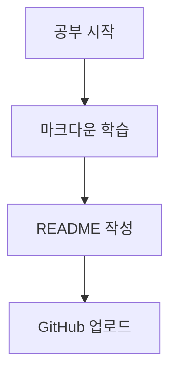

지금 정리한 내용을 보면 마크다운의 기본 문법은 상당히 잘 공부하고 있어요! 특히 제목, 글자 꾸미기, 목록, 체크박스, 링크, 이미지, 표, 인용문, 코드 블록까지 다뤘네요.

다만 몇 가지 문법이 잘못 이해된 부분이 있고, GitHub README.md에서 사용할 때 알아두면 좋은 문법도 있어요.

지금 작성한 내용을 기준으로 부족한 부분과 추가로 공부하면 좋은 내용을 정리해 드릴게요.

# 1. 지금 작성한 내용 중 수정할 부분

## ① 굵게, 기울임, 취소선

| 기능       | 올바른 문법      | 결과   |
| -------- | ----------- | ---- |
| 굵게       | `**텍스트**`   | 텍스트  |
| 기울임      | `*텍스트*`     | 텍스트  |
| 굵게 + 기울임 | `***텍스트***` | 텍스트  |
| 취소선      | `~~텍스트~~`   | 텍스트  |
| 인라인 코드   | `` `코드` ``  | `코드` |

주의할 점

`**`와 `*`를 조합할 때는 다음처럼 사용하면 됩니다.

```
***굵게 기울임***
```

네가 작성한 굵게 + 기울임 문법은 조금 복잡하게 조합되어 있어요. 별표 3개를 사용하는 방법이 가장 간단합니다.

## ② 형광펜

작성한 문법:

```
<mark>형광펜</mark>
```

이것은 HTML 문법입니다.


정상 작동

&#x20;GitHub Markdown에서도 사용할 수 있습니다.


형광펜 효과

단, 모든 마크다운 플랫폼이 `<mark>`를 동일하게 지원하는 것은 아닙니다.

## ③ 목록의 차이점

작성한 내용에서 중요한 부분이에요.

```
- 목록
* 목록
+ 목록
```

세 가지 모두 순서 없는 목록을 만드는 문법입니다.

결과는 동일합니다.

- 마이너스(-)
- 별표(\*)
- 플러스(+)

들여쓰기를 사용하면 하위 목록을 만들 수 있습니다.

```
- 1단계
    - 2단계
        - 3단계
            - 4단계
```

\- 1단계

- 2단계
  - 3단계
    - 4단계

## ④ 순서 있는 목록

작성한 내용 중 숫자 부분은 조금 더 정확하게 이해하면 좋아요.

```
1. 사과
2. 바나나
3. 포도
4. 수박
```

실제 작성할 때는 숫자를 반드시 순서대로 적지 않아도 됩니다.

```
1. 사과
1. 바나나
1. 포도
1. 수박
```

렌더링 결과:

1. 사과
2. 바나나
3. 포도
4. 수박

즉, 마크다운은 숫자 자체보다 목록의 순서 구조를 인식합니다.

## ⑤ 체크박스

체크박스는 GitHub README에서 특히 유용합니다.

```
- [ ] 공부하기
- [x] 마크다운 정리하기
- [ ] README 작성하기
```

결과:

- 공부하기
- 마크다운 정리하기
- README 작성하기

`[ ]`는 미완료, `[x]`는 완료입니다.

## ⑥ 줄바꿈과 문단 구분

이 부분은 조금 헷갈릴 수 있어요.

| 작성 방법      | 기능                      |
| ---------- | ----------------------- |
| Enter 한 번  | 편집기 및 플랫폼에 따라 줄바꿈 처리 차이 |
| 빈 줄 추가     | 새로운 문단                  |
| 줄 끝에 공백 2개 | 같은 문단 내 줄바꿈             |
| `<br>`     | 강제 줄바꿈                  |

예시:

```
첫 번째 문장  
두 번째 문장

세 번째 문장
```

결과:

첫 번째 문장\
두 번째 문장

세 번째 문장

참고로 VS Code에서 Markdown 미리보기는 `Ctrl + Shift + V`로 열 수 있습니다.

# 2. 추가로 반드시 공부하면 좋은 문법

여기부터는 네가 아직 정리하지 않은 문법 위주입니다.

## ① 제목과 부제목

```
# 제목 1
## 제목 2
### 제목 3
#### 제목 4
##### 제목 5
###### 제목 6
```

실제 결과:

# 제목 1

## 제목 2

### 제목 3

#### 제목 4

#### 제목 5

#### 제목 6

주의할 점은 `#` 다음에 공백을 넣는 것입니다.

```
# 제목    (올바른 방식)
#제목     (일반적으로 제목으로 인식되지 않음)
```

## ② 구분선

네가 공부한 `---`, `___` 외에도 `***`를 사용할 수 있습니다.

```
---
***
___
```

결과:

구분선 앞뒤에는 빈 줄을 넣는 습관을 들이면 다른 문법과 충돌할 가능성이 줄어듭니다.

## ③ 인용문 (Blockquote)

인용문은 `>` 기호를 사용합니다.

```
> 첫 번째 인용
>> 두 번째 인용
>>> 세 번째 인용
```

결과:

> 첫 번째 인용
>
> > 두 번째 인용
> >
> > > 세 번째 인용

주로 참고 자료, 설명, 중요 내용 등을 강조할 때 사용합니다.

## ④ 링크 연결

네가 공부한 링크 문법에서 중요한 부분은 링크 이름과 URL을 구분하는 것입니다.

```
[네이버](https://naver.com)
```

결과: [네이버](https://naver.com?utm_source=chatgpt.com)

여기서 이미지에 링크를 연결하는 방법도 알아두세요.

```
[](이동할URL)
```

핵심 문법

이것이 네가 작성한 이미지 클릭 시 네이버로 이동하는 문법의 올바른 형태입니다.

## ⑤ 이미지 삽입

```

```

예시:

[Minimalist Children Cute Characters Midjourney Prompt | PromptBase](https://images.openai.com/static-rsc-4/IhZ73ODEAbWySA9Lho-UjkU1tW-f3aRWU8wcaHndqj1748RONWAkyOxS9e9V8EGwvu00db_0oescdpve1JCA0j2dR7HVPMAHmzFx6CRZl2bDGB8xQCjFyCmuHqYjbuhK4qJja5nx2jj64ZeDLBh7oT-_FnlHdr91abHYN4cDlEg?purpose=inline)

```

```

여기서 알아야 할 추가 개념이 있습니다.

- `cat.png`: 프로젝트 내부 이미지 파일
- `https://...`: 인터넷에 있는 이미지 주소
- ``: 이미지를 표시하는 문법
- `[]()`: 링크를 표시하는 문법

## ⑥ 코드 블록

코드 블록은 백틱 3개를 사용합니다.

일반 코드:

````
```
코드 내용
```
````

언어 지정 코드:

````
```python
print("hello")
```
````

실제 결과:

```
print("hello")
```

언어를 지정하면 문법 강조(Syntax Highlighting)가 적용됩니다.

자주 사용하는 언어는 다음과 같습니다.

| 언어         | 지정 방법        |
| ---------- | ------------ |
| Python     | `python`     |
| JavaScript | `javascript` |
| HTML       | `html`       |
| CSS        | `css`        |
| SQL        | `sql`        |
| Bash       | `bash`       |
| JSON       | `json`       |

## ⑦ 표 만들기

표 문법도 잘 이해하고 있어요.

추가로 정렬 방법을 알아두면 좋습니다.

```
| 왼쪽 | 가운데 | 오른쪽 |
| :--- | :---: | ---: |
| 사과 | 바나나 | 포도 |
| 100 | 200 | 300 |
```

결과:

| 왼쪽 | 가운데 | 오른쪽 |
| -- | --- | --- |
| 사과 | 바나나 | 100 |
| 포도 | 수박  | 300 |

- `:---` 왼쪽 정렬
- `:---:` 가운데 정렬
- `---:` 오른쪽 정렬

## ⑧ HTML 문법 활용

마크다운에서 지원하지 않는 기능은 HTML을 일부 사용할 수 있습니다.

예를 들어:

```
<center>가운데 정렬</center>

<details>
<summary>자세히 보기</summary>

숨겨진 내용입니다.

</details>
```

실제 결과:

다만 `<center>`는 오래된 HTML 요소이므로 새로운 웹 문서에서는 CSS를 사용하는 것이 좋습니다. GitHub에서는 HTML 지원에도 제한이 있습니다.

## ⑨ 이모지 사용

GitHub에서는 이모지 단축 코드도 사용할 수 있습니다.

```
:smile:
:heart:
:fire:
:rocket:
:warning:
```

결과:

:smile: :heart: :fire: :rocket: :warning:

## ⑩ Mermaid 다이어그램

이건 꼭 추가로 공부해 보세요. 마크다운으로 순서도나 관계도를 그릴 수 있습니다.

````

````

